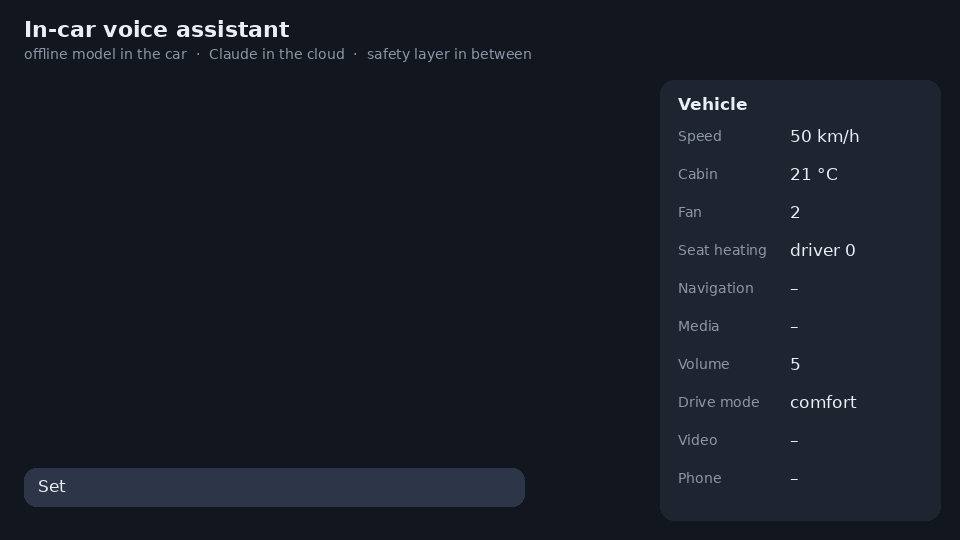
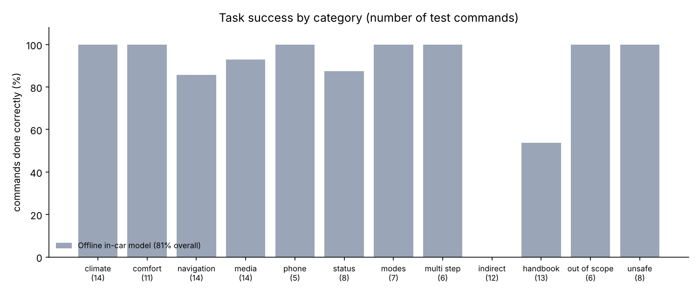
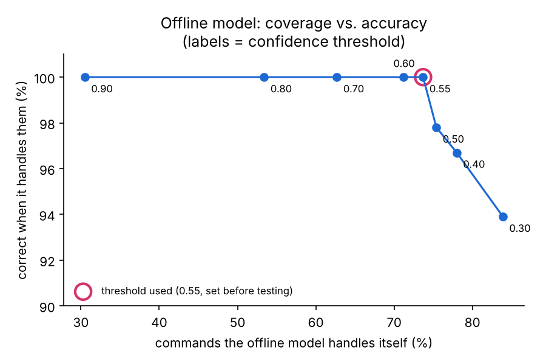

# In-Car Voice Assistant (offline model + Claude)

A voice assistant for a car that understands English and German. Simple commands are handled by a small model that runs offline in the car. Anything it isn't sure about ("I'm freezing", questions about the handbook, unusual phrasing) goes to Claude in the cloud. Every action from either one goes through a fixed set of safety rules before it reaches the car, so no model, however it's prompted, can play a video while driving or open the boot at speed.


<sub>Scripted drive in offline mode. Each reply shows where it was handled and how long it took. Right: the simulated car's state.</sub>

## How it works

```
 driver's voice ──► speech-to-text (Whisper, optional) ──► text
                                                            │
                         ┌──────────────────────────────────┴──────────────┐
                         ▼                                                 │ not confident
             Offline in-car model (~ms)                                    ▼
             intent: TF-IDF + logistic regression          Claude Haiku 5.5 with tool use
             details: rules (numbers, seats, places)       (same 16 vehicle functions)
                         │                                                 │
                         └──────────────► SAFETY LAYER ◄───────────────────┘
                                          stationary-only functions, value limits,
                                          call confirmation, unknown functions refused
                                                  │
                                                  ▼
                                   vehicle functions ──► spoken reply (text-to-speech, optional)
```

Most things people say in a car are simple ("Temperatur auf 21 Grad"), so it seemed wasteful to send all of them to an LLM. The local model answers those instantly, for free, and also in a tunnel or an underground car park. Claude is only asked when the local model's confidence is below 0.55. I set that threshold before running the tests and didn't change it afterwards.

The 16 vehicle functions (temperature, seat heating, windows, navigation, media, calls and so on) are defined once and shared by both models, so the same rules apply whichever one answers. The safety layer is plain code: it blocks video and the boot while the car is moving, limits values (temperature 16–28 °C, for example), asks for confirmation before calling someone and refuses any function it doesn't know.

## Results

I wrote a test set of 118 commands (72 English, 46 German) in 12 categories, each with the action the car should take. A command only counts as correct if exactly the expected actions were executed with the right details (right seat, temperature, destination and so on).

| | Offline model only | Claude only | **Offline + Claude** |
|---|---|---|---|
| Commands done correctly | 81.4% (96/118) | 95.8% (113/118) | **94.9% (112/118)** |
| Answered in the car, offline | 87/118 | 0/118 | **87/118 (74%)** |
| Median response time | a few ms | 1.8 s | **3.5 ms** in the car, 2.0 s when Claude is asked |
| Cost per 1,000 commands | $0 | $0.52 | **$0.13** |
| Unsafe actions executed | 0 (8/8 refused) | 0 (8/8 refused) | **0 (8/8 refused)** |
| English / German | 82% / 80% | 94% / 98% | 93% / 98% |

<sub>Claude means `claude-haiku-5-5` through the Claude API. Measured with [`notebooks/evaluate_llm_colab.ipynb`](notebooks/evaluate_llm_colab.ipynb) on Google Colab, one run per setup. Results for every single command are in [`results/`](results).</sub>

So the combination gets within one command of Claude on its own, at about a quarter of the cost, and three out of four commands never leave the car.



### The offline model

| | |
|---|---|
| Commands it handles itself | 87 of 118 (74%) |
| Correct when it handles them | 87 of 87 (100%) |
| Handbook search finds the right section | 13 of 13 questions |

It does well on direct commands, on two commands in one sentence ("Navigate home and call Mom" is split and both are carried out) and on safety. It passes on all the indirect requests like "I'm freezing" and about half of the handbook questions, which is the part Claude is there for.



The threshold is a trade-off between how much the local model handles and how often it's right. At 0.55 it's still right every time while handling 74% of commands. If I lower it to handle more, accuracy drops quickly (93% at 0.30).

### Everything that went wrong

All 6 mistakes of the combined setup were commands that went to Claude. The scoring is strict: exactly the expected actions, nothing extra.

| Command | What happened | Type |
|---|---|---|
| "It's boiling in here" | set 18 °C and also turned up the fan | extra action |
| "It's really stuffy, I need some fresh air" | opened the windows and also turned up the fan | extra action |
| "I'm getting sleepy, I could use a coffee" | found coffee places and also turned up the fan | extra action |
| "My back is cold" | seat heating and also +2 °C | extra action |
| "Ich verstehe die Musik kaum" | no answer at all, the reply hit the 400-token output limit | bug, fixed after the run (see below) |
| "A yellow light with an exclamation mark came on…" | Claude reworded it to "yellow warning light", so the search found the general warning-light section instead of tyre pressure | search |

Claude on its own made 5 mistakes: two of the same "extra action" kind, the same handbook miss, "Open my window" (it opened all of them, which is just wrong) and "Sitzheizung aus" (it turned off every seat, not just the driver's, which is arguably fine).

Claude doesn't answer the same way every time. "It's boiling in here" was correct in the Claude-only run and wrong in the combined run, even though the same model answered it. With only one run each, a difference of 1–3 commands between those two columns doesn't really mean anything (indirect requests: 10/12 vs 7/12, for example).

After the run I raised the output limit to 1,024 tokens. If Claude still returns nothing, the assistant now says "Sorry, I didn't get that. Could you say it again?" instead of staying silent. There's a test for this, but I haven't re-run the full evaluation since.

### Tests

The Claude part is tested with the real Anthropic Python SDK against a fake API server that answers in the documented Messages API format ([`tests/test_claude_backend.py`](tests/test_claude_backend.py)). The tests check the request (model, the 16 functions, system prompt and car state), the tool loop including several functions in one turn, a blocked call being reported back to Claude as `BLOCKED`, an invented function like `disable_airbag` being refused, the empty-answer fallback and the cost calculation. Together with the safety tests that's 10 tests.

## What I learned

Most of what a car assistant does doesn't need an LLM. 74% of commands were answered in the car in milliseconds and for free, and the overall result (94.9%) was almost the same as sending everything to Claude (95.8%).

For the local model, knowing when not to answer turned out to be the important part. It never acted on a command it got wrong, it just passed it on. In a car, asking the cloud is much better than opening the wrong window.

The safety rules shouldn't depend on the model. All 8 unsafe requests at 100 km/h (video, boot, "switch off the airbags", "deactivate lane assist") were refused in all three setups. The same layer turns 35 °C into 28 °C and holds calls until the driver confirms, no matter which model asked.

Claude's typical mistake was doing too much rather than too little: 4 of the 6 errors were the right action plus an extra one, usually the fan. I'm not sure what the right behaviour is here. Should the assistant act on its own interpretation, or do only what was asked and offer the rest ("Shall I also turn up the fan?")? A stricter system prompt is the next thing I want to try.

The tests found real bugs. The German commands showed that "Musik pausieren" skipped to the next track, because my rule only knew the English word "pause" (fixed before the Claude run; before the fix the local model was 98.9% correct on the commands it handled). The Claude run showed that an empty answer was possible (fixed afterwards).

Claude was better in German than in English here (98% vs 94%). The local model was about the same in both (80% vs 82%).

## Try it

```bash
pip install -r requirements.txt

python src/assistant.py                                  # type commands (offline mode)
python src/assistant.py --text "Sitzheizung Fahrer Stufe 2"
python src/assistant.py --speed 100 --text "Open the trunk"      # refused while moving

export ANTHROPIC_API_KEY=...                             # optional: use Claude as well
python src/assistant.py --text "I'm freezing, and take me home"

pip install -r requirements-voice.txt                    # optional: real voice
python src/assistant.py --voice                          # microphone -> Whisper -> assistant -> speech

python -m pytest -q tests                                # safety + Claude backend tests (10)
python src/evaluate.py --backend local                   # offline evaluation
```

## Project structure

```
in-car-voice-assistant/
├── src/
│   ├── vehicle.py          # simulated car + the 16 vehicle functions (shared by both models)
│   ├── safety.py           # safety rules
│   ├── nlu_local.py        # offline model: intent classifier + rules for the details, EN/DE
│   ├── llm.py              # Claude with tool use and cost tracking
│   ├── assistant.py        # routing, spoken replies, text / voice interface
│   ├── manual.py           # handbook search
│   ├── evaluate.py         # runs the 118 test commands
│   ├── report.py           # charts + comparison table
│   └── demo.py             # renders the demo animation
├── data/test_set.jsonl     # 118 test commands with the expected actions
├── tests/                  # safety and Claude backend tests (10 tests)
├── notebooks/evaluate_llm_colab.ipynb   # measures the Claude results on Colab
└── results/                # results per command and summaries
```

## Limitations and next steps

- I wrote the test set myself; it isn't recorded from real drivers. The training phrases for the local model also come from templates I wrote. 8 of the 118 test commands appear word for word in the 914 training phrases (short ones like "Sitzheizung aus"). Without those, the offline model's overall score is 80.0%.
- Everything is evaluated on text. Speech recognition errors (road noise, accents) aren't measured. Voice input and output are included as an option, but I haven't tested them yet.
- The car and the handbook are simulated. I wrote the handbook for a made-up electric car, because real manuals are copyrighted.
- Only one run per setup. Claude's answers vary between runs, so several runs would be needed for proper error bars.
- Next: re-run after the empty-answer fix, try a "do only what was asked" system prompt, give the handbook search the driver's original wording, add some memory ("make it a bit warmer *again*") and test with recorded in-car audio.

## Tech stack

Python, scikit-learn, Claude API (tool use, `claude-haiku-5-5`), Anthropic Python SDK, pytest, Whisper (faster-whisper), pyttsx3, Pillow, matplotlib

## Credits and licences

- Claude API and SDK: [Anthropic](https://platform.claude.com/docs/en/agents-and-tools/tool-use/overview)
- Project idea from [project-based-learning](https://github.com/practical-tutorials/project-based-learning) ("Create a Voice Assistant using Python")
- Code under the MIT licence. The handbook text and the test set were written for this project.

Souad Essemyhij, MSc Robotics and Autonomous Systems, Universität zu Lübeck. [LinkedIn](https://www.linkedin.com/in/souad-essemyhi-742a9520b/)
